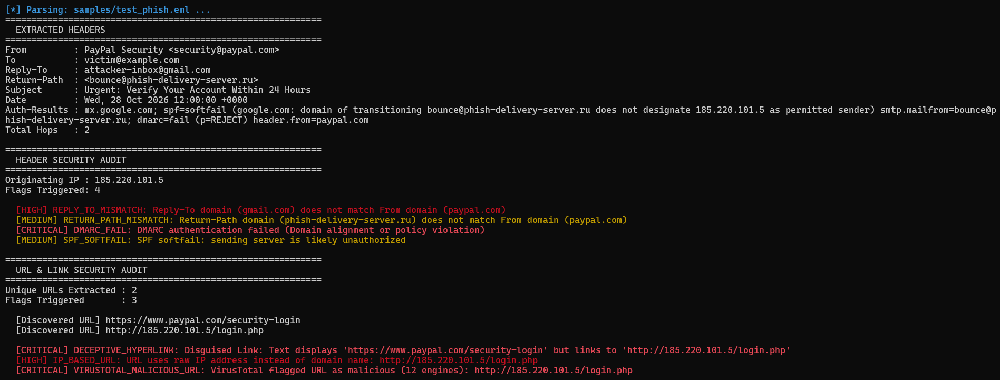
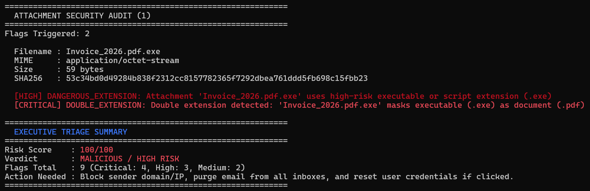

# Phishing Email Analyzer (CLI)

An automated email triage and forensic analysis tool built in Python. It parses raw `.eml` files, inspects header anomalies, audits authentication records (SPF, DKIM, DMARC), exposes disguised hyperlinks, detects dangerous attachments, queries threat intelligence via VirusTotal, and calculates a cumulative risk score with actionable SOC containment recommendations.

---

## Why I Built This

Phishing triage is one of the highest-volume tasks handled by Tier 1 SOC analysts and IT support teams. While modern email security gateways catch obvious spam, targeted phishing (BEC, credential harvesters, disguised links) still slips through. 

I built this tool to automate the manual inspection workflow: ripping apart the RFC 5322 MIME structure, comparing envelope versus header domains, verifying cryptographic signatures, unmasking obfuscated links, and checking threat intelligence—turning a 10-minute manual triage into a 2-second automated assessment.

---

## Key Capabilities

### 1. Header & Authentication Forensics
- **Sender Domain Alignment:** Identifies spoofing attempts by comparing the visible `From:` domain against the `Reply-To:` and `Return-Path:` (envelope sender) addresses.
- **Authentication Audit:** Parses the `Authentication-Results` header to detect `spf=fail`/`softfail`, `dkim=fail`, and `dmarc=fail` policy violations.
- **True Origin IP Extraction:** Recursively walks the `Received:` headers from bottom to top to identify the earliest public relay IP address that initiated transmission.

### 2. URL & Hyperlink Inspection
- **Anchor Text Disguise Detection:** Flags instances where the visible link text in HTML (e.g., `https://paypal.com`) points to an entirely different destination URL (e.g., `http://185.220.101.5/login.php`).
- **Heuristic Indicators:** Detects raw IP addresses used as hostnames, suspicious TLDs (`.xyz`, `.top`, `.click`, `.buzz`), and `@` credential injection tricks.
- **URL Unshortening:** Follows HTTP redirect chains for shortened URLs (`bit.ly`, `tinyurl.com`, `t.co`) to reveal the final landing page.
- **Threat Intelligence:** Queries VirusTotal API v3 for URL reputation metrics.

### 3. Attachment Security Auditing
- **Dangerous File Types:** Identifies executables, scripts, macro-enabled documents, and disk images (`.exe`, `.scr`, `.bat`, `.ps1`, `.docm`, `.xlsm`, `.iso`).
- **Double Extension Detection:** Uncovers masking attempts like `Invoice_2026.pdf.exe`.
- **Magic Bytes Verification:** Validates true file types against binary signatures (e.g., detecting Windows PE `MZ` headers inside files claiming to be PDFs).
- **Cryptographic Hashing:** Calculates MD5, SHA1, and SHA256 hashes and cross-references them with VirusTotal's file reputation database.

### 4. Risk Scoring & Triage Engine
- Translates forensic findings into weighted risk points (`CRITICAL`: 35 pts, `HIGH`: 20 pts, `MEDIUM`: 10 pts, `LOW`: 5 pts).
- Outputs a normalized 0–100 risk score, risk classification (`CLEAN`, `LOW`, `SUSPICIOUS`, `MALICIOUS`), and automated response guidance.

---

## Sample Triage Output





---

## Project Structure

```text
phishing-email-analyzer/
├── analyzer.py               # Main CLI driver and color-coded reporting dashboard
├── lib/
│   ├── parser.py             # RFC 5322 MIME parser (headers, multiparts, attachments)
│   ├── header_analyzer.py    # Domain mismatch detection and SPF/DKIM/DMARC validation
│   ├── url_analyzer.py       # Anchor tag extraction, heuristics, and VirusTotal URL lookup
│   ├── attachment_analyzer.py# Hashing, magic bytes, double extension, and VT hash lookup
│   └── scorer.py             # Weighted scoring model and triage verdict engine
├── screenshots/              # Terminal execution and triage screenshots
├── samples/                  # Sample .eml files for testing
├── .env.example              # Template for API keys
├── .gitignore
├── requirements.txt
└── README.md
```

---

## Installation & Usage

### 1. Clone the repository
```bash
git clone https://github.com/YOUR_USERNAME/phishing-email-analyzer.git
cd phishing-email-analyzer
```

### 2. Set up virtual environment & dependencies
```bash
python -m venv venv
# Windows:
.\venv\Scripts\activate
# Linux/macOS:
source venv/bin/activate

pip install -r requirements.txt
```

### 3. Configure API Keys
Create a `.env` file in the root folder (or copy from `.env.example`):
```env
VT_API_KEY=your_virustotal_api_key_here
```
*(Note: If no API key is provided, the tool runs all structural and heuristic checks offline without threat intelligence queries).*

### 4. Run an analysis
```bash
python analyzer.py samples/your_email.eml
```

---

## Detection Matrix

| Category | Indicator | Severity | Rationale |
|---|---|---|---|
| **Headers** | DMARC Failure | `CRITICAL` | Visible `From:` domain does not align with SPF/DKIM authentication. |
| **Headers** | Reply-To Mismatch | `HIGH` | Responses routed to an unassociated external inbox (common in BEC). |
| **Headers** | SPF Fail / Softfail | `HIGH` / `MEDIUM` | Originating host is not authorized by the sending domain's DNS. |
| **URLs** | Anchor Text Disguise | `CRITICAL` | HTML text shows a legitimate domain, but `href` routes to an external host. |
| **URLs** | Raw IP Hostname | `HIGH` | Legitimate corporate mail avoids unbranded, raw-IP infrastructure. |
| **URLs** | High-Risk TLD | `MEDIUM` | Known disposable or abuse-prone TLDs (`.top`, `.xyz`, `.buzz`). |
| **Attachments** | Double Extension | `CRITICAL` | Deliberately exploits default OS extension masking (`.pdf.exe`). |
| **Attachments** | Magic Byte Mismatch | `CRITICAL` | Binary executable (`MZ`) header masquerading under document extension. |
| **Attachments** | Executable / Script | `HIGH` | Direct execution risks (`.exe`, `.scr`, `.bat`, `.ps1`, `.vbs`). |
| **Threat Intel**| VirusTotal Detection | `CRITICAL` | Verified malicious signature or domain by external security vendors. |

---